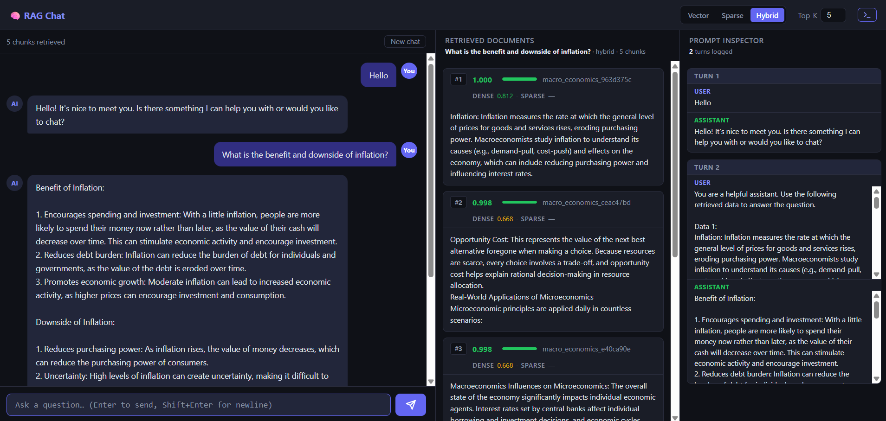
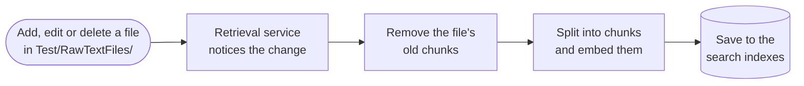
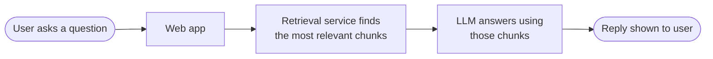
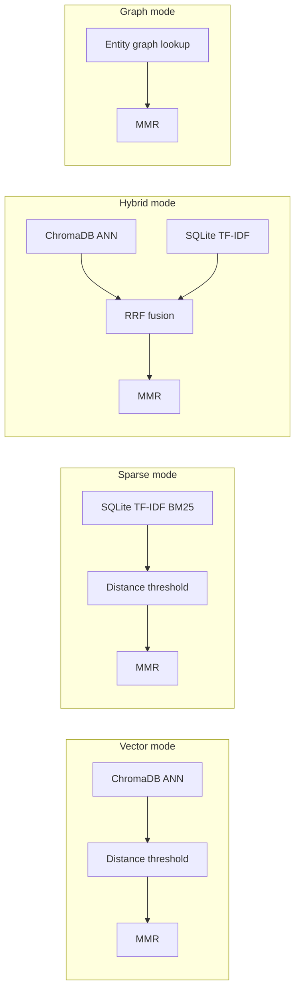

# RAG LLM Application

A Retrieval-Augmented Generation (RAG) system that indexes local text documents, plus news, blog and social posts from external feeds, and answers questions using a local Ollama LLM. Supports four retrieval modes — vector, sparse (TF-IDF), hybrid and graph — with Maximal Marginal Relevance re-ranking.

It runs as four HTTP services:

| Service | Entry point | Port | Owns |
|---------|-------------|------|------|
| **web** | `app.py` | 5000 | Browser UI, chat sessions, calls retrieval + Ollama |
| **retrieval** | `retrievalApp.py` | 5001 | ChromaDB, TF-IDF and graph indexes, embedding model, always-on ingestion (folder watcher) |
| **feed-poller** | `feedPollerApp.py` | 5002 | Fetches news / blog / SNS feeds on a schedule and sends new items to retrieval |
| **ollama** | `ollama serve` | 11434 | The LLM |

```
browser ──▶ web :5000 ──HTTP──▶ retrieval :5001 ──▶ ChromaDB / SQLite
                 └────HTTP──▶ ollama :11434
Test/RawTextFiles/ ──watched by──▶ retrieval (re-indexes on add / edit / delete)
RSS · Reddit · Mastodon · NewsAPI ──▶ feed-poller :5002 ──POST /ingest──▶ retrieval
```

Every chunk records where it came from (`sourceType`: `file`, `news`, `blog` or `sns`). Results show it as a badge, and you can filter by it in the UI and the API.

---

## Prerequisites

- Python 3.10+
- [Ollama](https://ollama.com) running locally with the `llama2` model pulled (`ollama pull llama2`)

```bash
pip install -r requirements.txt          # or requirements-web.txt / requirements-retrieval.txt per service
python -m spacy download en_core_web_sm
```

---

## Quick Start

### Docker Compose

```bash
docker compose up --build
docker compose exec ollama ollama pull llama2    # first run only
# open http://localhost:5000
```

Drop `.txt` files into `Test/RawTextFiles/`; they are indexed within a few seconds. The feed poller starts with the feeds in `feeds.example.json`. To use your own list, copy it to `feeds.json` and run `FEEDS_FILE=./feeds.json docker compose up`.

### Local (no Docker)

```bash
# 1. Start the retrieval service. It indexes Test/RawTextFiles/ on startup and then
#    watches the folder. On WSL with the repo under /mnt/c, set WATCH_POLLING=1.
python retrievalApp.py           # http://localhost:5001

# 2a. Start the web app (in another terminal)
python app.py                    # http://localhost:5000

# Optional: pull news / blog / SNS feeds into the index (uses feeds.json, or feeds.example.json)
python feedPollerApp.py          # http://localhost:5002

# 2b. Or use a CLI tool (these read the indexes directly)
python -m scripts.simpleQA       # RAG-augmented chat
python -m scripts.simpleSearch   # Search-only viewer
python -m scripts.simpleChat     # Plain chat (no RAG)
```

---

## Executable Files

### `retrievalApp.py` — Retrieval Service (always-on ingestion)

Owns all indexes. On startup it reconciles `Test/RawTextFiles/` with the indexes, then watches the folder:

| Change in the folder | What happens |
|----------------------|--------------|
| New file | Indexed |
| Edited file (content hash changed) | Old chunks deleted from every store, file re-indexed |
| Deleted / moved-out file | Chunks deleted from every store |
| Unchanged file / temp file (`.*`, `*.swp`, `*.tmp`, …) | Ignored |

Events are debounced (default 2 s) and every write goes through a single worker thread, so the three stores always share the same chunk IDs. A manifest (`tfidf_db/manifest.sqlite3`) stores each file's content hash.

**API endpoints:**

| Method | Path | Description |
|--------|------|-------------|
| `POST` | `/query` | `{query, mode?, topK?, tags?, sourceTypes?}` → retrieved chunks |
| `POST` | `/ingest` | `{sources: [{title, content, sourceType?, tags?, optional?}]}` → index text that isn't on disk |
| `POST` | `/ingest/delete` | `{titles: [...]}` → remove sources (the feed poller uses this to expire old items) |
| `POST` | `/ingest/rescan` | Re-scan the source folder now |
| `GET` | `/ingest/status` | Queue depth, last file, last error |
| `GET` | `/health` | Liveness check |

**Environment variables:** `SOURCE_FOLDER`, `WATCH_ENABLED` (default on), `WATCH_POLLING` (use on WSL `/mnt/c` and Windows bind mounts, where native file events don't arrive), `WATCH_POLL_INTERVAL_SECONDS`, `WATCH_DEBOUNCE_SECONDS`, `RETRIEVAL_PORT`.

---

### `feedPollerApp.py` — Feed Poller Service

Fetches external feeds on a schedule and sends new or changed items to the retrieval service, which indexes them like any other source. It keeps no search index of its own; it only remembers which items it already sent (`feed_db/state.sqlite3`).

- **No duplicates:** each item is keyed by its URL, so an edited article replaces its old version.
- **Retention:** items older than `retentionDays` are skipped, and removed from the index once they age out, so news doesn't crowd out your documents.
- **Failures:** a failing feed retries with a growing delay (capped at 1 h) and never blocks the other feeds.

**Feeds config** (`feeds.json`; see `feeds.example.json`):

```json
[
  {"name": "bbc-business", "connector": "rss", "url": "https://feeds.bbci.co.uk/news/business/rss.xml",
   "sourceType": "news", "intervalMinutes": 15, "retentionDays": 14},
  {"name": "reddit-economics", "connector": "reddit", "subreddit": "economics", "sourceType": "sns"}
]
```

| Connector | Fields | Notes |
|-----------|--------|-------|
| `rss` | `url` | Any RSS/Atom feed (most news sites and blogs). No key. |
| `reddit` | `subreddit`, `limit?` | Public JSON endpoint. No key. |
| `mastodon` | `instance`, `hashtag`, `limit?` | Public hashtag timeline. No key on most instances. |
| `newsapi` | `query`, `language?`, `pageSize?` | Needs `NEWSAPI_KEY` in `.env`. |

Every feed needs `name`, `connector` and `sourceType` (`news`, `blog` or `sns`). Optional fields: `intervalMinutes` (default 15), `retentionDays` (default 30), `enabled` (default true).

**API endpoints:** `GET /feeds/status` (per-feed item count, last poll, last error), `POST /feeds/<name>/poll` (poll now), `GET /health`.

---

### `updateData.py` — One-shot Sync

Does the same reconcile pass as the retrieval service's startup, once. Only needed when the retrieval service isn't running or its watcher is off (`WATCH_ENABLED=0`).

```bash
python -m scripts.updateData            # write the stores directly (service must be stopped)
python -m scripts.updateData --remote   # ask the running retrieval service to rescan
```

**What it does:**
1. Loads files from `Test/RawTextFiles/` and skips any whose content hash is unchanged
2. Cleans and splits each file into overlapping chunks (500 chars, 50 overlap)
3. Computes `all-MiniLM-L6-v2` sentence embeddings for each chunk
4. Tags each source with category labels via cosine similarity
5. Replaces the source's chunks in ChromaDB (`embeddings_db/`), TF-IDF (`tfidf_db/`) and the graph (`graph_db/`), and removes sources whose files were deleted

---

### `app.py` — Flask Web Application

Two-panel browser UI: left panel is a RAG chat interface; right panel shows retrieved document chunks and scores for debugging. Each result shows a source badge (📄 file · 📰 news · ✍️ blog · 💬 sns), links to the original article when it has a URL, and shows its publish date. The **Files / News / Blogs / SNS** chips in the top bar choose which sources to search. Retrieval goes to the retrieval service over HTTP (`RETRIEVAL_SERVICE_URL`, default `http://localhost:5001`); Ollama is reached via `OLLAMA_HOST`. If the retrieval service is down, chat still answers, just without context.



**Run:**
```bash
python retrievalApp.py   # in another terminal
python app.py            # Open http://localhost:5000
```

**API endpoints:**

| Method | Path | Description |
|--------|------|-------------|
| `GET` | `/` | Serves the HTML UI |
| `POST` | `/api/chat` | RAG-augmented chat turn (returns LLM reply + retrieved chunks) |
| `POST` | `/api/search` | Standalone document search (no LLM call) |
| `POST` | `/api/chat/reset` | Clear conversation history for a session |

**`/api/chat` request body:**
```json
{
  "sessionId": "abc123",
  "query": "What is machine learning?",
  "mode": "hybrid",
  "topK": 5
}
```

---

### `simpleQA.py` — CLI RAG Q&A Bot

Interactive terminal bot that retrieves relevant document chunks for every query and passes them to the LLM as context.

**Run:**
```bash
python -m scripts.simpleQA
```

**Commands:**

| Command | Description |
|---------|-------------|
| `/mode vector` | Semantic similarity search (default) |
| `/mode sparse` | TF-IDF keyword search |
| `/mode hybrid` | Reciprocal Rank Fusion of both |
| `/check` | Print full conversation history with chunk scores |
| `quit` / `exit` | Stop |

---

### `simpleSearch.py` — CLI Document Search Viewer

Inspect raw retrieval results without involving the LLM. Shows relevance scores, source titles, and full chunk text for each query. Useful for tuning retrieval quality.

**Run:**
```bash
python -m scripts.simpleSearch
```

**Commands:**

| Command | Description |
|---------|-------------|
| `/mode vector\|sparse\|hybrid` | Switch search mode |
| `/topk N` | Change number of results returned (default 5) |
| `quit` / `exit` | Stop |

---

### `simpleChat.py` — CLI Plain Chat (No RAG)

Minimal chatbot that talks directly to the LLM without any document retrieval. Useful for isolating LLM behaviour from the retrieval pipeline during development.

**Run:**
```bash
python -m scripts.simpleChat
```

---

## Workflow Diagrams

### Ingestion — Adding or Changing a Document



Unchanged files are skipped; a deleted file only has its chunks removed. Feed items follow the same steps: the feed poller sends them in instead of the folder watcher.

---

### Query Flow — User Sends a Message



If nothing relevant is found, the question is rewritten using the chat history and searched once more; if there is still nothing, the LLM answers without document context.

---

### Retrieval Mode Detail

Pick a mode in the UI (or `mode` in the API) to choose how chunks are found:

| Mode | How it finds chunks | Best for | Weak spot |
|------|---------------------|----------|-----------|
| **vector** (default) | Compares the *meaning* of your question with each chunk using sentence embeddings, so it matches even when the words differ. | Natural-language questions, paraphrases ("how do prices go up?" finds "inflation"). | Can miss exact names, codes or rare terms. |
| **sparse** | Matches *keywords* (TF-IDF): chunks that share rare words with your question score highest. | Exact terms, names, acronyms, IDs. | No understanding of synonyms; wording must overlap. |
| **hybrid** | Runs vector and sparse searches together and merges the two rankings, so a chunk ranked well by either rises to the top. | A safe all-round choice when you're unsure. | Slightly slower; runs two searches. |
| **graph** | Finds the people, organisations, places and other named entities in your question, then returns chunks that mention them or entities often mentioned alongside them. | Questions about specific entities and how they relate ("What happened in Indonesia?"). | Returns nothing if the question has no named entities. |

Before results reach the LLM, vector, sparse and hybrid drop weak matches below a similarity threshold. Every mode then thins out near-duplicate chunks (MMR), so the LLM sees varied, relevant context rather than the same point repeated.



---

## Architecture

```
app.py              — web service entry point (UI + chat)
retrievalApp.py     — retrieval service entry point (indexes + ingestion + watcher)
feedPollerApp.py    — feed poller entry point (external feeds → retrieval /ingest)
Controller/         — input handling: SearchData, LLMController, CategoryTagger,
                      RetrievalClient (HTTP to retrieval), FolderWatcher, RequestValidation
Controller/Connectors/ — one module per external source: rss, reddit, mastodon, newsApi
DatabaseService/    — business logic: RagService (retrieval), IngestionService (+ worker),
                      FeedPollerService (scheduling, de-duplication, retention), ChatService
DatabaseRepository/ — storage adapters: VectorRepository (ChromaDB), TfidfRepository, GraphRepository,
                      IngestManifestRepository, FeedStateRepository (SQLite)
LLMApi/             — thin Ollama SDK wrapper
Dto/                — data transfer objects: Source (+ SourceType), FeedItem, VectorDocument, ChatMessage, RetrievalResult
View/templates/     — Flask HTML templates
Test/               — unittest tests; RawTextFiles/ holds sample source documents
Config.py           — single source of truth for all thresholds, model names and service settings
docker/, docker-compose.yml — one image per service, plus the stock ollama image
```

---

## Configuration (`Config.py`)

| Parameter | Default | Description |
|-----------|---------|-------------|
| `EmbeddingModel` | `all-MiniLM-L6-v2` | Sentence transformer used for embeddings |
| `LLMModel` | `llama2` | Ollama model name |
| `MaxTextChunkLength` | `500` | Max characters per chunk |
| `OverLapChunkLength` | `50` | Chunk overlap in characters |
| `RetrievalTopK` | `15` | Candidate pool size fetched from ChromaDB |
| `MMRTopK` | `5` | Final chunks passed to the LLM after MMR |
| `MMRLambda` | `0.3` | MMR relevance/diversity balance (0 = max diversity) |
| `SimilarityThreshold` | `0.75` | L2 distance ceiling for vector results |
| `TfidfSimilarityThreshold` | `0.75` | Distance ceiling for TF-IDF results |
| `RRFk` | `60` | Reciprocal Rank Fusion constant |
| `MaxChatHistoryChars` | `5000` | History size before compaction |

Sensitive values (API keys, custom model paths) belong in `.env`, not in `Config.py`.

---

## Notes

- Only one process may write the indexes at a time: don't run `python -m scripts.updateData` (local mode) while `retrievalApp.py` is running — use `--remote` instead.
- `embeddings_db/`, `tfidf_db/` and `graph_db/` must share chunk IDs for hybrid and graph modes; always write through `RagService.addSources` / `deleteSource`.
- Docker uses named volumes for the indexes, so the first `docker compose up` re-indexes everything from `Test/RawTextFiles/`.
- Feed items are cleaned more gently than files: short lines are kept and URLs are stripped from a line instead of dropping it. Otherwise most social posts would be lost.
- On first start after upgrading, the retrieval service repairs older chunks: it sets `sourceType = file` and recovers missing titles from chunk IDs, so re-indexing replaces them instead of duplicating them.
- TF-IDF distances are stored as `1 - normalised_score` to match ChromaDB's convention (lower = more relevant).
