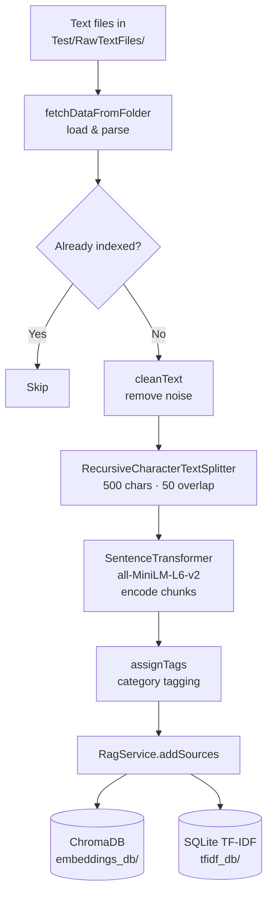
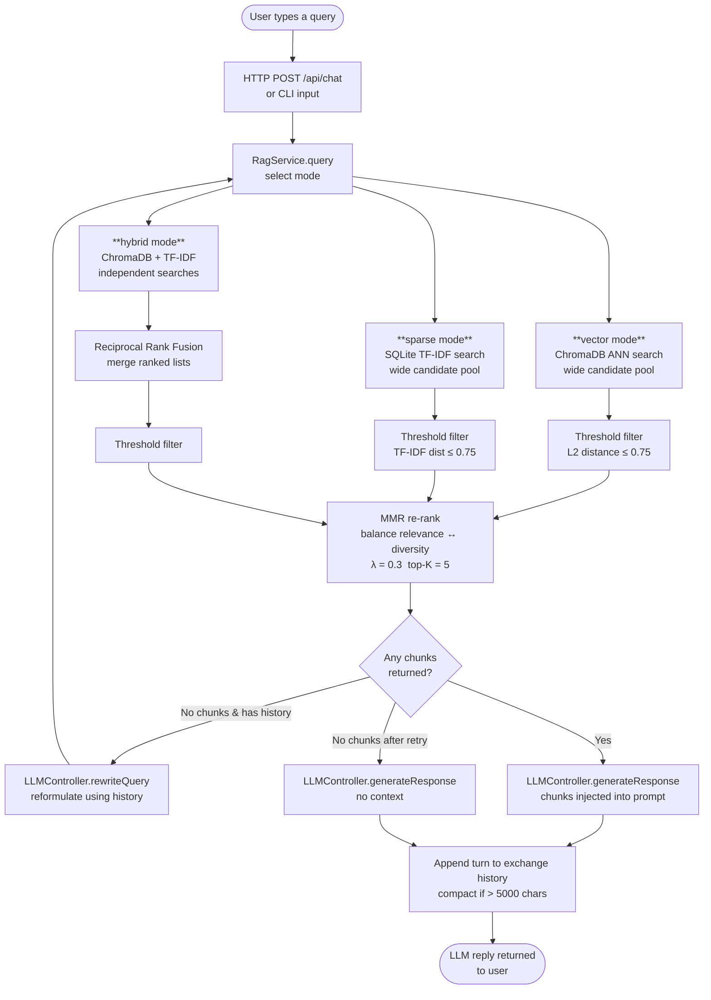
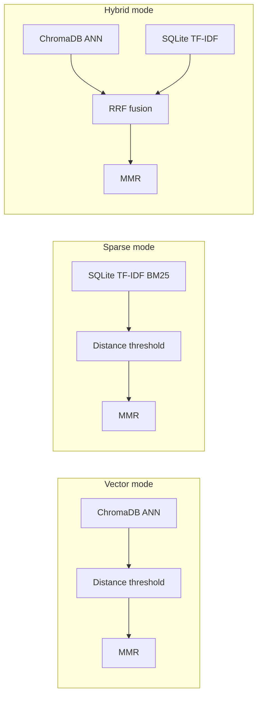

# RAG LLM Application

A Retrieval-Augmented Generation (RAG) system that indexes local text documents and answers questions using a local Ollama LLM. Supports three retrieval modes — vector, sparse (TF-IDF), and hybrid — with Maximal Marginal Relevance re-ranking.

---

## Prerequisites

- Python 3.10+
- [Ollama](https://ollama.com) running locally with the `llama2` model pulled (`ollama pull llama2`)

```bash
pip install -r requirements.txt
```

---

## Quick Start

```bash
# 1. Index your documents (run once, or whenever new files are added)
python updateData.py

# 2a. Start the web app
python app.py          # http://localhost:5000

# 2b. Or use a CLI tool
python simpleQA.py     # RAG-augmented chat
python simpleSearch.py # Search-only viewer
python simpleChat.py   # Plain chat (no RAG)
```

---

## Executable Files

### `updateData.py` — Data Ingestion

Indexes raw text files from `Test/RawTextFiles/` into both the ChromaDB vector store and the SQLite TF-IDF store. The script is idempotent — sources already in the database are skipped.

**Run:** once before starting the app, and again whenever new source files are added.

```bash
python updateData.py
```

**What it does:**
1. Loads `.txt` files from `Test/RawTextFiles/`
2. Cleans and splits each file into overlapping chunks (500 chars, 50 overlap)
3. Computes `all-MiniLM-L6-v2` sentence embeddings for each chunk
4. Tags each source with category labels via cosine similarity
5. Writes chunks + embeddings to ChromaDB (`embeddings_db/`) and SQLite (`tfidf_db/`)

---

### `app.py` — Flask Web Application

Two-panel browser UI: left panel is a RAG chat interface; right panel shows retrieved document chunks and scores for debugging.

**Run:**
```bash
python app.py
# Open http://localhost:5000
```

**API endpoints:**

| Method | Path | Description |
|--------|------|-------------|
| `GET` | `/` | Serves the HTML UI |
| `POST` | `/api/chat` | RAG-augmented chat turn (returns LLM reply + retrieved chunks) |
| `POST` | `/api/search` | Standalone document search (no LLM call) |
| `POST` | `/api/chat/reset` | Clear conversation history for a session |

**`/api/chat` request body:**
```json
{
  "sessionId": "abc123",
  "query": "What is machine learning?",
  "mode": "hybrid",
  "topK": 5
}
```

---

### `simpleQA.py` — CLI RAG Q&A Bot

Interactive terminal bot that retrieves relevant document chunks for every query and passes them to the LLM as context.

**Run:**
```bash
python simpleQA.py
```

**Commands:**

| Command | Description |
|---------|-------------|
| `/mode vector` | Semantic similarity search (default) |
| `/mode sparse` | TF-IDF keyword search |
| `/mode hybrid` | Reciprocal Rank Fusion of both |
| `/check` | Print full conversation history with chunk scores |
| `quit` / `exit` | Stop |

---

### `simpleSearch.py` — CLI Document Search Viewer

Inspect raw retrieval results without involving the LLM. Shows relevance scores, source titles, and full chunk text for each query. Useful for tuning retrieval quality.

**Run:**
```bash
python simpleSearch.py
```

**Commands:**

| Command | Description |
|---------|-------------|
| `/mode vector\|sparse\|hybrid` | Switch search mode |
| `/topk N` | Change number of results returned (default 5) |
| `quit` / `exit` | Stop |

---

### `simpleChat.py` — CLI Plain Chat (No RAG)

Minimal chatbot that talks directly to the LLM without any document retrieval. Useful for isolating LLM behaviour from the retrieval pipeline during development.

**Run:**
```bash
python simpleChat.py
```

---

## Workflow Diagrams

### Ingestion (`updateData.py`)



---

### Query Flow — User Sends a Message

The diagram below covers `app.py /api/chat` and `simpleQA.py`. The retrieval stage differs by mode; everything after it is identical.



---

### Retrieval Mode Detail



---

## Architecture

```
Controller/         — input handling: SearchData, LLMController, CategoryTagger
DatabaseService/    — business logic: RagService (retrieval), ChatService (plain chat)
DatabaseRepository/ — storage adapters: VectorRepository (ChromaDB), TfidfRepository (SQLite)
LLMApi/             — thin Ollama SDK wrapper
Dto/                — data transfer objects: Source, VectorDocument, ChatMessage, RetrievalResult
View/templates/     — Flask HTML templates
Test/               — unittest tests; RawTextFiles/ holds sample source documents
Config.py           — single source of truth for all thresholds and model names
```

---

## Configuration (`Config.py`)

| Parameter | Default | Description |
|-----------|---------|-------------|
| `EmbeddingModel` | `all-MiniLM-L6-v2` | Sentence transformer used for embeddings |
| `LLMModel` | `llama2` | Ollama model name |
| `MaxTextChunkLength` | `500` | Max characters per chunk |
| `OverLapChunkLength` | `50` | Chunk overlap in characters |
| `RetrievalTopK` | `15` | Candidate pool size fetched from ChromaDB |
| `MMRTopK` | `5` | Final chunks passed to the LLM after MMR |
| `MMRLambda` | `0.3` | MMR relevance/diversity balance (0 = max diversity) |
| `SimilarityThreshold` | `0.75` | L2 distance ceiling for vector results |
| `TfidfSimilarityThreshold` | `0.75` | Distance ceiling for TF-IDF results |
| `RRFk` | `60` | Reciprocal Rank Fusion constant |
| `MaxChatHistoryChars` | `5000` | History size before compaction |

Sensitive values (API keys, custom model paths) belong in `.env`, not in `Config.py`.

---

## Notes

- `updateData.py` must be run before `app.py` on a fresh setup — the app crashes if the ChromaDB collection `my_docs` does not exist.
- Both `embeddings_db/` and `tfidf_db/` must be populated from the same `updateData.py` run for hybrid mode to work correctly (they must share chunk IDs).
- TF-IDF distances are stored as `1 - normalised_score` to match ChromaDB's convention (lower = more relevant).
